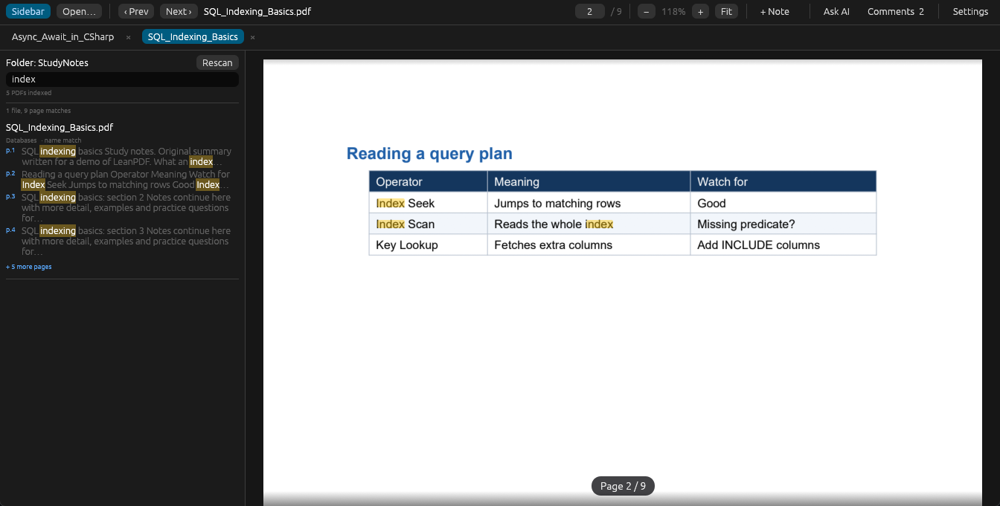
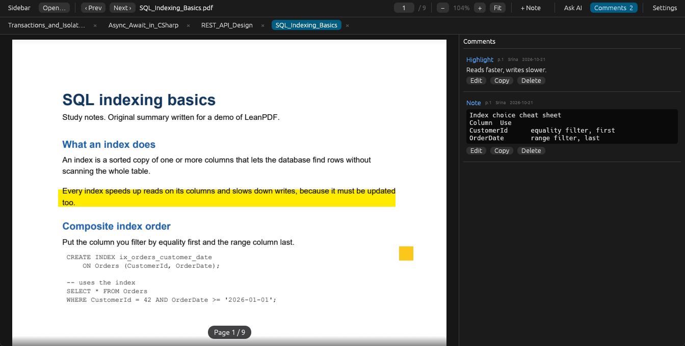
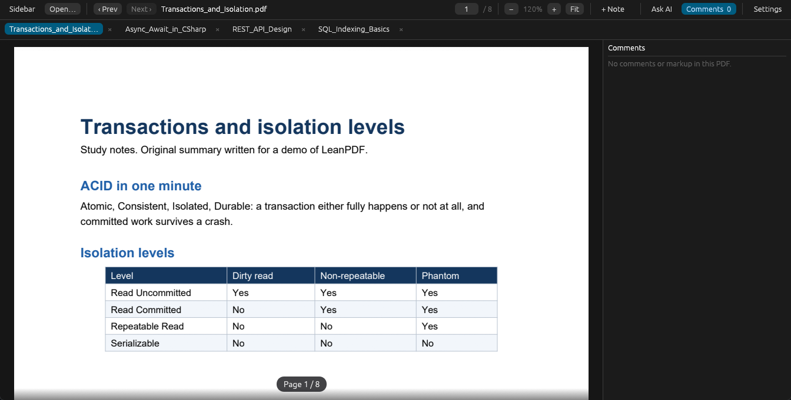

<p align="center">
  
</p>

<h1 align="center">LeanPDF</h1>

<p align="center">
  A small, fast PDF reader for Windows with folder-wide text search and comments that Adobe Acrobat can read.<br>
  Open a folder once, search every PDF in it, click a hit to land on the page, then search again.
</p>

<p align="center">
  <a href="https://github.com/srinadhmanchikalapudi/leanpdf/releases/latest"><b>Download for Windows</b></a> &nbsp;·&nbsp;
  <a href="#install">Install</a> &nbsp;·&nbsp;
  <a href="#using-the-app">Using the app</a> &nbsp;·&nbsp;
  <a href="#build-from-source">Build from source</a>
</p>

<p align="center">
  
  
  
  
  <a href="https://github.com/srinadhmanchikalapudi/leanpdf/actions/workflows/ci.yml"></a>
</p>

<p align="center">
  
</p>

<p align="center">
  
  
</p>

---

## Install

1. Open the [latest release](https://github.com/srinadhmanchikalapudi/leanpdf/releases/latest) and download **`LeanPDF-Setup-<version>.exe`** (about 7 MB).
2. Run it. If Windows shows a blue **"Windows protected your PC"** screen, that is expected (the installer is not code-signed): click **More info**, then **Run anyway**. It installs just for you and needs no administrator password.
3. Open **LeanPDF** from the Start menu. The installer can also add it to the **Open with** list for PDFs; it never changes your default PDF app.

Uninstalling removes the program only. Your PDFs are never touched, and you are asked whether to delete LeanPDF's small settings and search index.

## What it does

- **Light and quick.** PDFium (the engine inside Chrome) draws only the pages near the screen and frees the rest, so memory stays flat on huge PDFs. The native app uses about 120 MB with a PDF open, and Windows' Task Manager shows far less than that once it has been idle for a few seconds.
- **Search a whole folder.** Pick a folder once; it is remembered. Every PDF under it is indexed (SQLite full text, only changed files are re-read). Type in the sidebar to see file names, page numbers and snippets. Click a hit to open that page with the matches highlighted, then search again for the next one.
- **Tabs.** Every PDF you open gets its own tab; opening one that is already open just switches to it. Middle-click or the x closes a tab, Ctrl+W closes the current one, Ctrl+Tab / Ctrl+Shift+Tab move between tabs. Drag a tab to reorder it, as in Acrobat. Your tabs come back, in your order, the next time you start the app.
- **Ask AI about your PDFs.** Open the **Ask AI** panel (Ctrl+J) and ask questions about the open PDF, such as "Summarize this" or "What does it say about renewal?". LeanPDF picks the relevant pages and sends only that text to **OpenRouter** or **Anthropic**, using your own API key (kept in Windows Credential Manager, never in a file). Answers stream in, cite pages as clickable sources, and a note under each answer says exactly how many pages were sent. Tick "Also search other PDFs in this folder" to let it pull pages from the rest of your folder too. Costs are whatever your provider charges; roughly 5-15k tokens per question. The feature adds only a few MB of RAM, because the model runs on the provider's servers.
- **Updates inside the app.** LeanPDF checks GitHub once a day and shows a bar when a new version is out; **Update now** downloads it, verifies its checksum, installs it and restarts. **What's new** shows the changes, and a window shows them once after each update.
- **Page number always in view.** A small "Page 5 / 20" label floats over the page and updates as you scroll; put it at the bottom, bottom right or top right, or turn it off in Settings.
- **Settings** (Ctrl+,): scroll speed, theme, interface size, page-number position, comment author name, reopening tabs, the AI provider, key and model (a dropdown filled from the provider), and update options.
- **A folder tree.** Click a folder to limit the search to it. **Prev / Next** walk through the files in tree order and skip any that cannot be opened.
- **Comments that work with Adobe.** Existing comments (highlights, notes, underlines, text boxes) are listed in a panel; click one to jump to it.
  Select text to **highlight** (four colors), **underline**, **strike through**, **highlight with a comment**, or **copy**. **+ Note** places a sticky note. Edit, copy or delete any comment from the panel (Adobe's comments are editable too), or double-click a comment on the page. Pasted tables and code keep their line breaks, tabs and monospace look.
- **Safe saving.** Changes autosave as a PDF *incremental update*: the file's existing bytes are never rewritten, so Acrobat keeps everything it wrote, and your comments show up in Acrobat as ordinary comments (checked against Adobe Acrobat DC, qpdf and pypdf).
- Works offline. Nothing leaves your computer, except the update check and the AI questions you choose to ask.

## Using the app

| Key | Action |
| --- | --- |
| Ctrl+K / Ctrl+Shift+F | Focus folder search |
| Enter (in search) | Open the first result |
| Alt+Left / Alt+Right | Previous / next PDF in the folder (replaces the current tab) |
| Ctrl+O | Open a single PDF (in a new tab) |
| Ctrl+W | Close the current tab |
| Ctrl+Tab / Ctrl+Shift+Tab | Next / previous tab |
| Ctrl+B | Show / hide the sidebar |
| Ctrl+= / Ctrl+- / Ctrl+0 / Ctrl+1 | Zoom in / out / fit width / 100% (Ctrl + mouse wheel also zooms) |
| Ctrl+J | Open / close the Ask AI panel |
| Ctrl+, | Settings |
| N | Sticky-note tool |
| Ctrl+C | Copy the selected text |
| Ctrl+S | Save now (otherwise it saves about a second after a change) |

Scanned PDFs (pictures of pages) have no text to search; they are marked **scan** in the tree.

## Build from source

Needs Rust (stable), and for the web-view app Node 22+. Windows only.

```
# native app (this is what the installer ships)
powershell -ExecutionPolicy Bypass -File tools\publish.ps1            # LeanPDF.exe + zip in dist\
powershell -ExecutionPolicy Bypass -File tools\publish.ps1 -Installer # also the setup program (needs Inno Setup)

# or by hand
cargo build --release --manifest-path native/Cargo.toml
```

Every version needs a `## x.y.z` section in `CHANGELOG.md`: it becomes the release notes and the in-app "What's new". `tools\publish.ps1` downloads `pdfium.dll` (pdfium-binaries, Chromium build 7881) into `pdfium/` if it is missing. To publish a version, push a tag such as `v0.1.0`: the release workflow builds the installer and attaches it.

### How the repository is laid out

| Folder | What it is |
| --- | --- |
| `core/` | The shared engine: PDFium worker, text selection, comment editing and incremental save, folder index, settings |
| `native/` | **LeanPDF**, the native app (Rust + egui/OpenGL, no browser engine) |
| `src-tauri/`, `src/` | An alternative web-view front end (Tauri + WebView2) with the same features; it uses more memory |
| `installer/` | Inno Setup script |
| `vendor/pdfium-render` | pdfium-render 0.9.4 plus one added function, `save_incremental_to_writer` |

Both apps share their settings and search index in `%APPDATA%\app.leanpdf.desktop`.

Memory with one PDF open (committed): native about 120 MB, web-view about 225 MB.

## Notes

- After an incremental save PDFium omits `/Type /XRef` from the new cross-reference stream when the original used xref streams (Acrobat's do); `core/src/pdf.rs` patches that in so strict readers accept the file.
- Not built yet: OCR for scanned PDFs, rotated-page overlay handling, comment reply threads.

## License

MIT. See [LICENSE](LICENSE) and [THIRD-PARTY-NOTICES.md](THIRD-PARTY-NOTICES.md).
